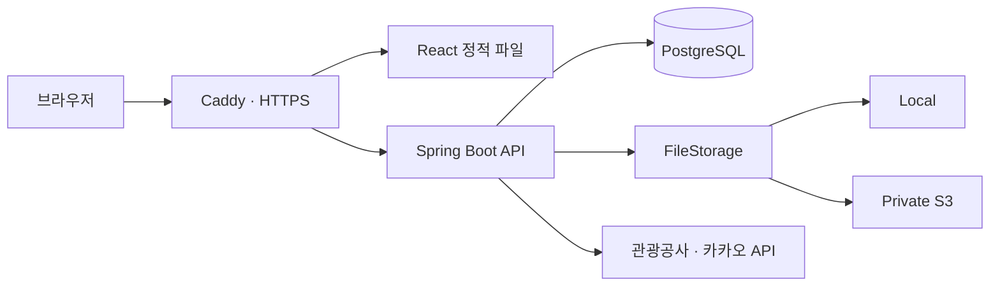

<p align="center">
  
</p>

# Into the Picture

**사진으로 여행지를 발견하고, 나의 여행을 사진으로 기록하는 서비스**

관광 사진과 공모전 수상작에서 여행지를 발견하고, 직접 촬영한 사진을 지역별 앨범에 기록합니다. 같은 장소의 수상작과 내 사진을 비교하고, 공개한 비교 사진을 다른 사용자와 공유할 수 있습니다.

**[서비스 바로가기](https://intothepicture.duckdns.org/)** · **[설계 문서](docs/README.md)** · **[개발 기록](docs/development-log/README.md)**

- **기간:** 2026.06.27 ~ 2026.09.22, 약 12주 — 최초·최종 커밋 기준
- **규모:** 1인 개발 · AI 에이전트 활용
- **담당:** 서비스 구조·API·데이터 계약 설계, 역할별 AI 에이전트 작업 구성, 구현 결과 통합 및 검증

## 주요 기능

| 기능 | 설명 |
|---|---|
| 관광 사진 탐색 | 키워드로 관광 사진을 검색하고 여행지 발견 |
| 수상작 탐색 | 지역·계절·수상 정보에 따라 작품을 탐색하고 지도에서 위치 확인 |
| 방문 시기 참고 | 지원하는 관광지에 대해 집중률 예측과 추천 방문일 확인 |
| 개인 여행 앨범 | 최대 3장의 사진을 여행 기록으로 묶고 촬영일·지역·메모 관리 |
| 사진 비교·공개 | 수상작과 내 사진을 나란히 비교하고 공개 여부 관리 |
| 로그인·즐겨찾기 | 카카오 로그인, 수상작 즐겨찾기 및 개인 기록 관리 |

사진·수상작 탐색과 공개 비교 사진 조회는 로그인 없이 이용할 수 있습니다. 개인 앨범·즐겨찾기·비교 관리에는 카카오 로그인이 필요합니다. 외부 데이터가 없는 관광지에는 집중률이나 길안내 기능을 표시하지 않습니다.

## 기술 스택

| 구분 | 기술 |
|---|---|
| Backend | Java 17 호환, Spring Boot 3.3.5, Spring Data JPA, Spring Security |
| Frontend | React 18, TypeScript, Vite 5, TanStack Query, Tailwind CSS |
| Database | PostgreSQL / Supabase, Flyway |
| Storage | Local filesystem, AWS S3 |
| External | 한국관광공사·공공데이터포털 API, 카카오 로그인·지도·장소 검색 |
| Deployment | Docker, Docker Compose, Docker Hub, Caddy |
| Test | JUnit 5, Mockito, MockMvc |

## 서비스 구조



- 프런트엔드와 API는 하나의 도메인에서 제공하며, Caddy가 `/api/*` 요청을 백엔드로 전달합니다.
- 개인 파일은 API에서 소유권을 확인하고, 공개 비교 파일은 공개 설정을 확인한 뒤 제공합니다. `/files/**` 정적 접근은 차단합니다.
- 외부 API 구현은 Provider 인터페이스 뒤에 두고 도메인 로직과 분리합니다.
- DB 스키마와 데이터 보정 이력은 Flyway로 관리합니다.

## 주요 설계와 문제 해결

### 1. 접근 정책을 유지하는 Local·S3 저장소 전환

- `FileStorage`로 저장·조회·삭제를 분리하고 `APP_STORAGE_TYPE` 설정으로 구현체를 선택합니다.
- 저장 키 `u/{userId}/…`와 기존 파일 조회 API를 유지해 저장소 변경이 클라이언트에 전파되지 않도록 구성했습니다.
- S3 공개 URL 대신 서버의 권한 검사 경로를 사용합니다.
- Local/S3 단위 테스트와 로컬 Docker의 실제 S3 업로드를 확인했습니다. 기존 파일 이관과 실제 S3 조회·삭제의 배포 검증은 별도 작업입니다.

### 2. DB와 파일 저장소 사이의 실패 처리

- 정상 삭제는 DB의 `afterCommit`에서 파일을 삭제해, 롤백된 기록이 이미 삭제된 파일을 가리키는 위험을 줄였습니다.
- 묶음 업로드 중 예외가 발생하면 앞서 저장한 파일을 추적해 보상 삭제합니다.
- Mock 저장소와 트랜잭션 콜백 단위 테스트로 삭제 시점·롤백 시 파일 유지·업로드 실패 정리를 확인합니다.
- 커밋 후 파일 삭제 실패나 최종 DB 커밋 실패까지 자동 복구하는 구조는 아니며, 재시도·고아 파일 정리는 후속 과제입니다.

### 3. 외부 장소 데이터의 오류·누락 보정

- 넓은 지역명이나 동명 장소로 발생한 위치 오류를 검토하고, 기존 DB와 신규 수집 경로에 보정 기준을 반영했습니다.
- 카카오 장소 ID를 확인하지 못한 경우 임의 목적지로 대체하지 않고 길안내를 표시하지 않습니다.
- 수상작·앨범의 지역 코드 불일치는 후속 Flyway 마이그레이션으로 수정하며, 이미 적용한 마이그레이션은 변경하지 않습니다.

상세 근거: [저장소 전환](docs/development-log/M8.3-s3-selectable-storage.md), [데이터 안전성·조회 개선](docs/development-log/M10-album-data-safety-and-query.md), [촬영지 보정](docs/development-log/M3.1-contest-location-corrections.md), [지역 코드 정규화](docs/development-log/M10.1-contest-location-code-normalization.md)

## 로컬 실행

### 준비 사항

- JDK 17 이상, Node.js 20 / npm
- 접속 가능한 PostgreSQL과 스키마를 생성·변경할 수 있는 개발용 DB 계정
- 공공데이터포털 API 인증키, 카카오 애플리케이션 키
- S3 모드를 사용하는 경우 AWS 자격 증명과 비공개 버킷

실행 시 Flyway가 DB에 마이그레이션을 적용하므로 개발용 DB를 사용합니다. Local 모드에는 AWS 자격 증명이 필요하지 않습니다.

### 1. 저장소와 환경 설정 준비

```bash
git clone https://github.com/gyoseok17/into-the-picture.git
cd into-the-picture
cp backend/.env.example backend/.env
cp frontend/.env.example frontend/.env
```

PowerShell에서는 `cp` 대신 `Copy-Item`을 사용할 수 있습니다. 복사한 파일의 값을 채웁니다.

| 위치 | 변수 | 용도 |
|---|---|---|
| `backend/.env` | `DB_HOST`, `DB_PORT`, `DB_NAME`, `DB_USERNAME`, `DB_PASSWORD` | 개발용 PostgreSQL 연결 |
| `backend/.env` | `JWT_SECRET` | UTF-8 기준 최소 32바이트의 무작위 서명 키 |
| `backend/.env` | `DATA_GO_KR_KEY` | 관광공사·공공데이터포털 API 인증키 |
| `backend/.env` | `KAKAO_REST_KEY` | 로그인 인가 코드 교환·장소 검색 |
| `backend/.env` | `KAKAO_CLIENT_SECRET` | 카카오 콘솔에서 Client Secret을 사용하는 경우 설정; 미사용 시 빈 값 |
| `backend/.env` | `APP_STORAGE_TYPE` | `local`(기본값) 또는 `s3` |
| `backend/.env` | `APP_STORAGE_LOCAL_DIR` | Local 저장 경로, 기본값 `./uploads` |
| `backend/.env` | `AWS_REGION`, `APP_STORAGE_S3_BUCKET` | S3 선택 시 필요한 리전·버킷 |
| `frontend/.env` | `VITE_API_BASE` | 기본값 `/api/v1` |
| `frontend/.env` | `VITE_KAKAO_JS_KEY` | 브라우저에서 사용하는 카카오 JavaScript 키 |

`VITE_` 변수는 브라우저 번들에 포함됩니다. DB 비밀번호·JWT 서명 키·카카오 Client Secret·AWS 비밀키를 넣지 않습니다. 실제 `.env`와 업로드 파일은 Git 추적 대상에서 제외합니다.

`backend/.env`는 Java properties 형식의 `KEY=value`로 작성합니다. DB·JWT 값은 YAML 기본값 없이 이 파일이나 실행 환경에서 주입합니다.

카카오 개발자 콘솔에는 웹 플랫폼 도메인 `http://localhost:5173`과 Redirect URI `http://localhost:5173/login`을 등록합니다. 서버 REST 키와 프런트 JavaScript 키는 같은 카카오 애플리케이션의 값을 사용합니다.

### 2. 백엔드 실행

```bash
cd backend
./gradlew bootRun
```

- Windows PowerShell: `./gradlew.bat bootRun`
- API 주소: `http://localhost:8080/api/v1`
- `backend/.env`는 백엔드 실행 작업 폴더를 기준으로 읽습니다.
- 스키마는 `backend/src/main/resources/db/migration`의 Flyway 이력으로 관리하며, Hibernate의 `ddl-auto`는 `none`입니다.

### 3. 프런트엔드 실행

별도 터미널에서 프로젝트 루트를 기준으로 실행합니다.

```bash
cd frontend
npm ci
npm run dev
```

- 브라우저 주소: `http://localhost:5173`
- Vite가 `/api` 요청을 로컬 백엔드 `8080`으로 전달합니다.
- 지도·로그인에는 JavaScript 키가 필요합니다. 키가 없으면 해당 기능이 제한됩니다.

### 4. 수상작 데이터 최초 적재

새 DB는 마이그레이션만으로 외부 수상작 데이터가 채워지지 않습니다. 정상 백엔드 실행을 중지한 뒤, `backend/`에서 한 번 실행합니다.

```bash
./gradlew bootRun --args='--external.dataload.enabled=true'
```

Windows에서는 `./gradlew.bat`을 사용합니다. 수상작 수집 → 좌표 보강 → 카카오 장소 ID 보강 → 집중률 대상 매칭 순으로 실행합니다. 외부 API 인증과 호출 한도의 영향을 받으며, 일반 실행에서는 이 옵션을 사용하지 않습니다.

### 5. 로컬에서 S3 사용

- `APP_STORAGE_TYPE=s3`, `AWS_REGION`, `APP_STORAGE_S3_BUCKET`을 설정하고 호스트의 AWS CLI/SSO 자격 증명을 준비합니다. Local/S3 전환 시 기존 파일은 자동 이관되지 않습니다.
- SDK 기본 자격 증명 체인을 사용하므로 AWS 접근 키를 프로젝트 파일에 넣지 않습니다. 특정 프로필은 실행 환경의 `AWS_PROFILE`로 선택합니다.
- 과거 Docker 검증에 사용한 `backend/docker-compose.local.yml`은 개인 환경별 Git 제외 파일로, 새로 클론한 저장소에는 포함되지 않습니다.
- 컨테이너에서 로컬 자격 증명을 사용하려면 AWS 프로필 폴더를 읽기 전용으로 연결하는 오버라이드를 별도로 준비해야 합니다. 호스트·WSL 경로와 프로필명은 본인 환경에 맞추고, 운영 Compose에는 연결하지 않습니다.

## 테스트와 빌드

백엔드 작업 폴더:

```bash
./gradlew test
./gradlew bootJar
```

프런트엔드 작업 폴더:

```bash
npm ci
npm run build
```

백엔드는 인증·권한, 업로드 검증, 저장소 어댑터, 파일 삭제 콜백, 업로드 보상, 외부 데이터 변환 등을 테스트합니다. S3 SDK와 외부 API를 Mock으로 검증하는 테스트는 실제 AWS·외부 서비스 통합 검증을 대신하지 않습니다. 프런트엔드 `build`는 TypeScript 검사와 Vite 번들 생성을 수행합니다.

## Docker 배포

배포용 Compose는 소스를 빌드하지 않고 Docker Hub의 백엔드·프런트 이미지를 실행합니다.

1. `backend/.env`에 운영 DB·API·JWT 설정과 `APP_DOMAIN`을 작성합니다. 도메인은 `https://` 없이 입력합니다.
2. `APP_IMAGE_TAG`에 사용할 배포 버전을 지정합니다. Compose의 기본값은 `m8.3`이며, 현재 소스와 같다고 가정하지 않고 배포할 이미지 버전을 선택합니다.
3. 도메인이 서버를 가리키도록 DNS를 설정하고 외부에서 `80`·`443` 포트에 접근할 수 있게 준비합니다.
4. 카카오 콘솔에 배포 도메인과 `https://<도메인>/login`을 등록하고 실행합니다.

```bash
cd backend
docker compose pull
docker compose up -d
```

- Caddy가 HTTPS와 API 프록시를 담당하며, 백엔드 `8080`은 호스트에 공개하지 않습니다.
- HTTPS Compose는 refresh 쿠키의 `Secure`를 활성화하고 도메인에서 허용 출처를 구성합니다.
- Gradle 로컬 HTTP 실행에서는 refresh 쿠키의 `Secure` 기본값이 `false`입니다. HTTPS 운영에서는 `APP_AUTH_REFRESH_COOKIE_SECURE=true`를 유지합니다. Refresh 토큰은 JSON 응답 대신 HttpOnly 쿠키로 전달합니다.
- `backend/.env`는 백엔드에만 주입하며, DB·JWT·서버 API 비밀값을 프런트 컨테이너에 전달하지 않습니다.
- 카카오 JavaScript 키는 프런트 이미지 빌드 시 포함됩니다. 서버 `.env`만 수정해서는 교체되지 않습니다.
- S3는 비공개 버킷을 사용하고, EC2 배포 시 IAM 역할로 자격 증명을 제공합니다. 사진용 `u/*` 객체에 필요한 `GetObject`·`PutObject`·`DeleteObject` 권한으로 범위를 제한합니다.
- Local 업로드는 `itp-uploads` 볼륨에 보존됩니다. 중지는 `docker compose down`으로 수행하며, `down -v`는 보존 데이터를 삭제하므로 일반 중지에 사용하지 않습니다.
- Local 볼륨은 컨테이너 재생성에는 유지되지만 호스트·볼륨 손실이나 다중 서버의 파일 공유까지 해결하지 않습니다. Caddy의 인증서·상태는 `caddy_data`·`caddy_config` 볼륨에 보존합니다.

관련 설계는 [배포 도메인 설계](docs/development-log/M8.5-deployment-origin-configuration.md)를 참고하세요.

## 저장소 구조

```text
backend/          Spring Boot API, 테스트, Flyway, 배포 Compose
frontend/         React 웹, 기능별 UI·API·상태 관리, Caddy
docs/             서비스 설계와 버전별 개발 기록
design-process/   외부 API·데이터 설계 검증용 Python 스크립트
_workspace/       역할별 계약·구현·QA 상세 근거
.claude/          역할별 AI 에이전트·스킬 설정
AGENTS.md         공통 작업·검토·통합 규칙
```

백엔드 패키지 루트는 `com.intothepicture`입니다. `domain/`은 기능별 Controller·Service·Repository·엔티티·Provider 계약을, `external/`은 외부 API 구현을, `global/`은 인증·설정·공통 응답과 예외 처리를 담당합니다.

## 개발 방식과 참고 문서

백엔드·외부 연동·프런트엔드·QA 역할의 AI 에이전트를 활용했습니다. 개발자는 요구사항과 계약 결정, 역할별 작업 조율, 결과 통합·검토와 검증을 담당했습니다. AI 에이전트는 프로젝트 참여 인원에 포함하지 않습니다.

- [설계 문서 목차](docs/README.md)
- [API 명세](docs/04-api-spec.md)
- [인증 흐름](docs/05-auth.md)
- [개인 사진·공개 비교 접근 정책](docs/10-m6-photo-record.md)
- [버전별 구현·QA 기록](docs/development-log/README.md)
- [역할 분담과 검토 규칙](AGENTS.md)
- [소스 공개 전 비밀정보 점검 결과](docs/publication-review.md)

문서에는 초기 설계와 후속 변경 기록이 함께 있습니다. 현재 동작은 구현 코드와 해당 기능의 최신 개발 기록을 함께 확인하세요.
